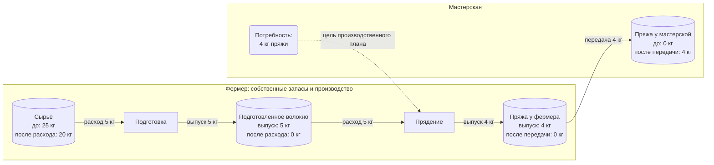

# CFN для фермера: сырьё → волокно → пряжа → мастерская

Дата: 12 октября 2026. Интерфейс: **Carbon Farm Network App 0.6.0 в Moss 0.15.8**. Здесь объяснены существующие учебные записи CommonGround Lab. Физических поставок и денежных операций не было. Результаты проверки приложения — в [отчёте цикла](CFN_CYCLE_RESULTS.md).

Главная идея CFN: описать, **у кого есть конкретный запас, какой процесс его использует, что получается и кому передаётся результат**. Карточка задания должна быть связана с этими данными.

## 1. Кто участвует в нашем примере

| Участник | Имя в CFN | Что делает по плану | Что получает |
| --- | --- | --- | --- |
| Фермер, первый пользователь Moss | `CG CFN Farm 2026-10-12` | Вносит свои 25 кг сырья; берёт 5 кг; выполняет подготовку и прядение; передаёт 4 кг пряжи | Промежуточные продукты собственного производства; оплату в этом опыте не моделировали |
| Мастерская, второй пользователь Moss | `CG CFN Workshop 2026-10-12` | Создаёт запрос на 4 кг пряжи; должна принять готовую пряжу | По плану — 4 кг пряжи от фермера; по данным проверки передача не изменила её запас |

В этом примере **обе производственные стадии выполняет фермер**. Мастерская не предоставляет станок, труд или деньги. Мы ещё не проверяли цепочку «фермер отдаёт сырьё отдельному переработчику, тот оказывает услугу и возвращает продукт».

Названия «подготовка» и «прядение» объясняют учебные операции. Соотношения 5→5→4 кг заданы для теста; это не технологический норматив. Разница 1 кг не описана отдельным потоком отходов или потерь. В рабочем рецепте её нужно объяснить.

## 2. Как читать английские термины

### Запасы и производство

| Термин CFN / ValueFlows | Как назвать по-русски | Что означает в нашем примере |
| --- | --- | --- |
| Agent | Участник / хозяйство | Фермер или мастерская. Запись хозяйства и учётная запись пользователя — связанные, но отдельные понятия |
| Resource Specification | Вид ресурса / описание продукта | «Сырьё», «Подготовленное волокно», «Пряжа». Это каталог видов |
| Economic Resource | Конкретный ресурс / партия | Именно ваша партия 25 кг сырья с номером и количеством |
| Unit | Единица измерения | `kilogram`, кг |
| Inventory | Запасы / склад | Перечень существующих партий и остатков |
| Tracking Identifier | Номер партии / метка отслеживания | В нашем тесте `commonground-cfn-2026-10-12-raw`; в хозяйстве — понятный номер партии |
| Primary Accountable | Ответственный за ресурс | Для наших партий это хозяйство, которое мы считаем владельцем; это поле само по себе не доказывает права пользователя |
| Accounting Quantity | Количество в учёте прав на ресурс | Сколько относится к вашему хозяйству по учёту |
| Onhand Quantity | Количество в фактическом распоряжении | Сколько находится у вас; может отличаться от учёта прав, например при перевозке |
| Process Specification | Вид операции | «Подготовка», «Прядение» |
| Process | Конкретная операция производства | Подготовить именно эту порцию сырья в данном заказе |
| Stage | Пройденная стадия | После какой операции вышла партия. В CFN связана с видом операции |
| Recipe Process | Шаблон операции / рецепт | Повторяемая схема: какие входы нужны и какие выходы ожидаются |
| Recipe Flow | Вход или выход рецепта | Например, расход 5 кг сырья или выпуск 5 кг волокна |
| Plan | Производственный план | Связанные операции для выполнения заказа |

«Вид ресурса» и «партия» — разные записи: запись «Пряжа» в каталоге ещё не означает, что на складе появилась пряжа. Количество в фактическом распоряжении также не равно количеству, свободному от резервов. Эти различия описаны в [ValueFlows: ресурсы](https://www.valueflo.ws/concepts/resources/); рецепты и планы — в [рецептах](https://www.valueflo.ws/concepts/recipes/) и [планировании](https://www.valueflo.ws/concepts/plan/).

### Потребность, обещание и факт

| Термин | Русское название | Пример |
| --- | --- | --- |
| Request | Потребность / запрос | Мастерской нужны 4 кг пряжи |
| Offer | Предложение | Фермер предлагает пряжу или свою работу. В нашем опыте Offer не создавали |
| Intent | Намерение | «Хочу получить 4 кг пряжи»; поставщик ещё может быть неизвестен |
| Proposal | Опубликованное предложение / запрос | Объявление, через которое Intent показывается сети; так сохранён запрос мастерской |
| Commitment | Плановое обязательство | «Фермер должен передать мастерской 4 кг пряжи» либо плановый вход/выход его собственного процесса |
| Economic Event | Хозяйственное событие / факт | Запись «израсходовано 5 кг» или «передано 4 кг» |
| Fulfillment | Исполнение обязательства | Связь факта с обещанным действием; возможно частичное исполнение |
| Agreement | Соглашение | Общие условия обмена: что предоставляют стороны, что считается выполнением |
| Provider | Предоставляющий участник / поставщик | Кто предоставляет материал, результат или работу в этой записи |
| Receiver | Получающий участник / получатель | Кто получает материал, результат или работу |

В ValueFlows Intent, Commitment и Economic Event описывают разные состояния потока: потребность, плановое действие и наблюдённый факт. В планировании возможны ещё не назначенные обязательства. Это определения [ValueFlows: потоки](https://www.valueflo.ws/concepts/flows/). В тестовом CFN обязательства созданы как диагностические записи; согласие двух людей и исполнимое соглашение ими не доказаны.

В установленном CFN исполнение видно через связанные события у обязательства. Создание отдельной стандартной записи Fulfillment не подтверждено; подробности адаптера вынесены в отчёт цикла.

### Зачем вообще Commitment

Он отвечает на вопрос: **«Что должно быть сделано, кем, для кого и в каком количестве?»** Событие отвечает: **«Что записано как уже сделанное?»**

Например, обязательство — передать мастерской 4 кг. Первый факт передачи 1 кг исполняет его частично; остаётся 3 кг. Так можно показать ход выполнения и отклонение от плана. Создание самого обязательства ещё не подтверждает резерв партии или изменение её остатка.

Для нашей цепочки были созданы пять обязательств:

| Обязательство | Плановое действие | Provider → Receiver |
| --- | --- | --- |
| C1 | Израсходовать 5 кг сырья в подготовке | Фермер → фермер |
| C2 | Выпустить 5 кг подготовленного волокна | Фермер → фермер |
| C3 | Израсходовать 5 кг волокна в прядении | Фермер → фермер |
| C4 | Выпустить 4 кг пряжи | Фермер → фермер |
| C5 | Передать 4 кг пряжи мастерской | Фермер → мастерская |

Одинаковые provider и receiver в C1–C4 означают внутреннее производство хозяйства. Продукт пока не переходит другому участнику. C5 описывает межхозяйственную передачу. Исполнение C1–C4 связалось с событиями, но расход не изменил склад: для надёжного учёта одной этой связи недостаточно.

## 3. Схема того, что должно произойти

На схеме показан **ожидаемый поток**, а не успешный результат нынешнего CFN. Цилиндры обозначают партии, прямоугольники — операции, подписи стрелок — действия и количества.

Пять стрелок соответствуют C1–C5. Для каждого записанного факта должна быть видна конкретная партия; 5 кг на стрелке расхода — объём из партии, а не автоматически созданный новый склад.

## 4. Где что находится в CFN

Откройте **Moss → CommonGround Lab → Carbon Farm Network App**. Справочники находятся в меню с аватаром **внутри CFN**, справа вверху.

| Раздел | Русское название | Когда нужен |
| --- | --- | --- |
| Map | Карта хозяйств | Найти участника географически |
| Offers | Предложения | Опубликовать доступный продукт или услугу |
| Requests | Потребности | Запросить нужный продукт |
| Plans | Производственные планы | Посмотреть операции и плановые входы/выходы |
| Exchanges | Обмены | Посмотреть обменные записи; для этого опыта сквозное исполнение не подтверждено |
| Activity | Журнал хозяйственных событий | Посмотреть записанный расход, выпуск, передачу |
| Inventory | Склад / запасы | Посмотреть партии и остатки |
| Cash | Денежный раздел | В этом опыте не использовался |
| Agents, Units, Resource specifications, Process specifications, Recipes | Участники, единицы, виды ресурсов, виды операций, рецепты | Подготовить общие справочники |

В нынешнем стенде участники, kilogram, виды ресурсов, операции и рецепты **уже созданы**. Следующие шаги объясняют их устройство; для просмотра существующего примера повторное создание не требуется.

## 5. Подготовка сети: один раз, затем переиспользовать

Эту часть может делать человек, который настраивает общую сеть. Фермеру не нужно заново создавать справочники для каждого заказа.

1. **Agents → Add an agent**: заведите хозяйства. В нашем примере первый пользователь создал Farm, второй — Workshop. `Name` — название; `Role in the network` — роль. Тестовые роли были `test supplier` и `test maker and receiver`. Форма также требовала координаты и logo; в тесте использованы условные данные.
2. **Units**: найдите `kilogram` / `kg`.
3. **Resource specifications → Add a resource specification**: опишите Raw fiber — сырьё, Prepared fiber — подготовленное волокно, Yarn — пряжу; укажите kg. Это ещё не остатки склада.
4. **Process specifications → Add a process specification**: Initial — начальная стадия, Prepare — подготовка, Spin — прядение.
5. **Recipes → Add a recipe**: задайте два шаблона. `Add an input` — добавить вход; `Add an output` — выход.

Если `Create` остаётся неактивной при уже показанном kilogram, явно выберите единицу в списке: в нашем тесте видимое значение по умолчанию не всегда было заполненным значением формы.

| Рецепт | Вход | Выход |
| --- | --- | --- |
| Подготовка | Raw fiber, `consume`, 5 kg, стадия Initial | Prepared fiber, `produce`, 5 kg, стадия Prepare |
| Прядение | Prepared fiber, `consume`, 5 kg, стадия Prepare | Yarn, `produce`, 4 kg, стадия Spin |

`Provider Role` / `Receiver Role` в рецепте — роли участников шаблона. В наших рецептах обе были `test supplier`, соответствуя фермеру. В конкретном плане используются конкретные участники.

## 6. Фермер: внести свою существующую партию

**Inventory → Beginning Balance** — «Склад → Начальный остаток». Это описание уже имеющегося сырья при начале учёта.

| Поле | Что выбрано в тесте |
| --- | --- |
| Provider / Receiver | Farm / Farm |
| Resource specification | Raw fiber |
| Action | `raise` — ввод начального остатка |
| Quantity / Unit | 25 / kilogram |
| Resource Name | `CG CFN Raw lot 2026-10-12` |
| Resource Stage | Initial |
| Resource Tracking Identifier | `commonground-cfn-2026-10-12-raw` |
| Description | Пометка учебной партии |

После **Add** партия должна появиться в Inventory. Начальный остаток 25 кг в нашем тесте сохранён правильно. При известной поставке нужно описывать фактическое получение соответствующим действием; `raise` здесь использован именно для начального ввода.

## 7. Мастерская: запросить готовый продукт

Во втором профиле: **Requests → Add a request** — «Потребности → Добавить запрос».

Выберите `Receiver = Workshop`, `What is requested from the network = Yarn`, `Quantity = 4`, `Unit = kilogram`; в описании укажите, для чего нужна пряжа. Нажмите **Create**. Пока поставщик не определён, это потребность. Она появилась в нашей сети и была прочитана первым пользователем.

## 8. Фермер: составить план и договориться об исполнении

**Plans → Add a plan → Create from requests** — «Планы → Добавить план → Создать по потребностям». В замысле приложения запрос должен стать основанием для расчёта необходимых операций и материалов.

**В проверенном релизе на нашем примере этот шаг не завершился:** запрос появился справа, производственная цепочка не построилась. Карандаш у запросного обязательства дал ошибку `Cannot read properties of null (reading 'id')`.

Поэтому для уже подготовленного стенда откройте существующий **CG CFN Two-stage API plan 2026-10-12**. Его создал проверочный сценарий через API: фермер не построил его обычными кликами. В нём две стадии и обязательства C1–C5. Это позволяет изучить выполнение независимо от неисправного генератора.

В рабочем процессе на этом шаге стороны должны подтвердить количества, сроки, конкретные партии и условия передачи. Отдельное соглашение о цене, приёмке и оплате в нашем опыте не создавалось. `Total cost: $0` означает отсутствие рассчитанной стоимости в этом примере; бесплатную поставку оно не доказывает.

## 9. Фермер: записать выполненную работу

На карточке входа/выхода в плане нажмите значок календаря: **Record Economic Event → Add Events** — «Записать хозяйственный факт → Добавить события».

| Что записывает фермер | Действие | Количество | Ожидаемое влияние |
| --- | --- | ---: | --- |
| Сырьё использовано для подготовки | `consume` — израсходовать | 5 кг | Запас сырья 25→20 |
| Подготовленное волокно изготовлено | `produce` — выпустить | 5 кг | Новый запас волокна 5 |
| Волокно использовано в прядении | `consume` | 5 кг | Запас волокна 5→0 |
| Пряжа изготовлена | `produce` | 4 кг | Новый запас пряжи 4 |

Это последовательность фактов в нашем опыте. После них CFN показал `events 5 kilogram` / `events 4 kilogram` и по одному связанному событию у каждого обязательства.

**Фактические остатки оказались 25 кг сырья, 5 кг волокна и 4 кг пряжи.** События consume сохранились без указания конкретной партии, поэтому склад не уменьшился. У новых партий отсутствовала стадия. Галочка или число событий у обязательства пока не подтверждают правильного списания.

Просмотр существующих событий — через **Activity**; остатки — через **Inventory**. Весь пример уже записан: добавление ещё одного расхода будет новым событием.

## 10. Передать пряжу мастерской

Логика передачи: фермер предоставляет 4 кг своей партии пряжи, мастерская получает их; у фермера должно остаться 0, у мастерской появиться 4.

В проверенном пути карточки C5 отдельного календаря не было. Мы использовали **Activity → Add an event**, выбрали `Provider = Farm`, `Receiver = Workshop`, `Resource specification = Yarn`, `Action = transfer`, `Quantity = 4 kg` и нажали **Add**.

Запись передачи появилась в журнале. **Ресурс к получателю не перешёл по учёту:** у фермера осталось 4, у мастерской 0. Ссылки на исходную и конечную партии отсутствуют, C5 не связан с этим фактом. Подтверждение приёмки мастерской и оплата не выполнялись.

Мы дополнительно проверили передачу отдельной тестовой партии через API с обоими ID: она тоже не изменила остатки. Поэтому ручная инструкция не может обещать успешное завершение этого шага в нынешнем CFN.

## 11. Остальные действия: как их понимать

| Action | По-русски | Пример применения |
| --- | --- | --- |
| `consume` | Израсходовать | Сырьё превращается в продукт или расходуется |
| `produce` | Выпустить | Появилась новая пряжа |
| `use` | Использовать без расходования самого предмета | Станок занят на время работы; он остаётся станком |
| `work` | Вложить труд | Записать 2 часа работы; эти часы в нашем тесте не вводили |
| `cite` | Использовать информацию / сослаться | Использовать технологическую инструкцию |
| `accept` / `modify` | Принять в обработку / изменить | Работа с тем же идентифицируемым предметом. `accept` здесь не означает приёмку покупателем заказа |
| `pickup` / `dropoff` | Забрать / доставить | Транспортировка и физическая передача на её концах |
| `transfer` | Передать права и физическое распоряжение | Передача пряжи другому хозяйству |
| `transfer-all-rights` | Передать права | Права перешли, товар физически может оставаться у прежнего хранителя |
| `transfer-custody` | Передать на хранение / в распоряжение | Отдать оборудование во временное владение без передачи прав |
| `move` | Переместить | Перенести партию в другой склад своего хозяйства |
| `raise` / `lower` | Увеличить / уменьшить остаток корректировкой | Начальный ввод или сверка запасов |

В разных версиях UI имена некоторых actions пишутся через дефис, подчёркивание или camelCase. Выбирать нужно доступное действие соответствующей формы. Значения приведены по [ValueFlows: действия](https://www.valueflo.ws/concepts/actions/) и [передачи](https://www.valueflo.ws/concepts/transfers/); работоспособность всех этих действий в нашем CFN не проверена.

## 12. Что с диаграммой

В проверенном CFN есть **представление плана колонками стадий**, с карточками входов и выходов. Вот [скриншот нашего плана](evidence/cfn-plan.png). Map — географическая карта хозяйств.

Свободного редактирования такой схемы, как выше — с разными блоками, произвольным связыванием партий и операций и явной проверкой резервов — наш проверенный путь CFN не дал. Предложение для CommonGround: [Svelte Flow и ресурсная доска ValueFlows](VALUEFLOWS_EDITOR_PROPOSAL.md).

Для фермера основной экран разумно строить вокруг понятных действий: **«Мои запасы → Нужный продукт → План производства → Подтвердить свой вклад → Записать выполнение → Передать и принять результат»**. Термины ValueFlows можно оставить в подробностях записи, а на кнопках использовать русский язык.
